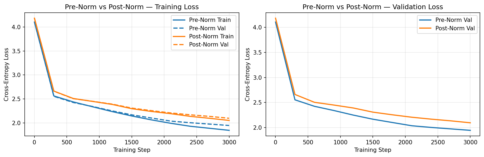
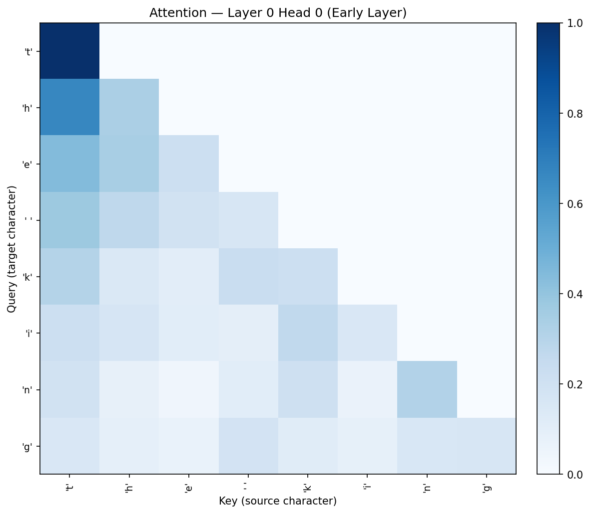
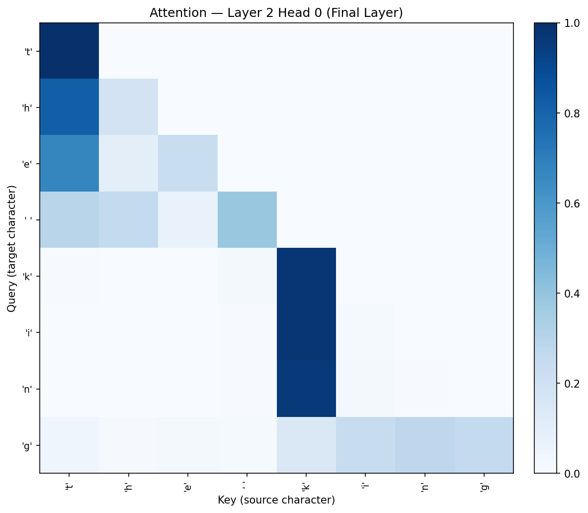

# Decoder-only Transformer Language Model from Scratch

A GPT-style character-level language model (161K parameters) trained on Tiny Shakespeare,
built using only `nn.Linear`, `nn.LayerNorm`, `nn.Embedding` and tensor ops
(no `nn.Transformer`, no HuggingFace).

## Architecture
- Causal multi-head self-attention (d_model=64, 4 heads, 3 layers, context 128)
- Learned positional embeddings, GELU feed-forward (4x), dropout 0.1
- Weight tying between token embedding and LM head
- Adam (lr 3e-4), gradient clipping at 1.0

## Results: Pre-Norm vs Post-Norm (same seed, 3000 steps)
| Variant   | Final Val Loss | Perplexity |
|-----------|---------------:|-----------:|
| Pre-Norm  | 1.9455         | 7.0        |
| Post-Norm | 2.0960         | 8.1        |

Pre-Norm converged faster at every checkpoint: the clean residual path gives
better gradient flow early in training.



## Attention patterns ("the king")
| Layer 0 (local patterns) | Layer 2 (word-boundary anchoring) |
|---|---|
|  |  |

## Also included
- Temperature sampling analysis (T = 0.2 / 1.0 / 1.5)

## Run
```
pip install -r requirements.txt
```
Then open `tiny_transformer.ipynb` (the dataset downloads automatically).

Dataset: [Tiny Shakespeare](https://raw.githubusercontent.com/karpathy/char-rnn/master/data/tinyshakespeare/input.txt)
